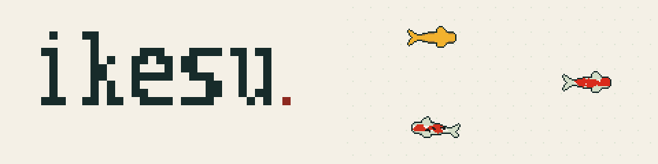

[English](README.md) | 日本語

**エージェントを池で育てる。**

AI のコーディングエージェントをたくさん並べて見守るための端末多重化ツール（terminal multiplexer）。手元と SSH 先の複数マシンのワークスペース・タブ・ペインを1つの画面にまとめて表示し、エージェント同士のメッセージ送信や、待たずに走らせる長時間ジョブを扱えます。

- 手元と SSH 先のマシンのスペースを1つのサイドバーに並べ、マウスやキーで行き来できる
- エージェントの状態（判断待ち・作業中・完了）をサイドバーと端末のタイトルに表示する
- `ikesu send` / `ikesu inbox` による消えないメッセージ、`ikesu run` による背景ジョブと完了通知
- サーバーを新しい版へ引き継いでも、動いているペインは止まらない（live handoff）
- macOS では、エージェントの判断待ちに答えるネイティブのパネルを使える
- サイドバーでエージェントの数だけピクセルアートの錦鯉が泳ぎ、エージェントの様子を見せる

仕様は [SPEC.md](SPEC.md) にあります。

## 対応環境

macOS（Apple Silicon・Intel）と Linux（arm64・amd64）。判断待ちパネルは Apple Silicon の macOS のみです。

## インストール

Homebrew で入れます。

```sh
brew install kazuph/tap/ikesu
ikesu --version
```

[GitHub Releases](https://github.com/kazuph/ikesu/releases) から各環境の実行ファイルを直接取得することもできます。

## 使い方

```sh
ikesu                      # 既定のセッションを開く（無ければ作る）
ikesu --session work       # 名前付きのセッションを開く
ikesu help                 # コマンドの一覧と使い方
```

prefix キーの既定は `ctrl+b` です。`prefix ?` でキー操作の一覧を表示します。

### エージェントを動かす

```sh
ikesu agent start reviewer -- claude          # ペインでエージェントを起動
ikesu send <pane> "テストを直して"             # エージェントへメッセージを送る
ikesu run --label tests -- go test ./...      # 待たずに走らせ、終わったら呼び出し元へ通知
ikesu log <job_id>                            # ジョブの結果を読む
```

### 複数のマシンをまとめる

```sh
ikesu machine add mini.local --label mini
ikesu machine list
```

追加したマシンのスペースはサイドバーに並びます。`keys.next_workspace` / `keys.previous_workspace`（例: `cmd+j` / `cmd+k`）は、マシンをまたいでスペースを順に移ります。相手のマシンも同じ版の ikesu が必要です。SSH の鍵や認証は OpenSSH の設定をそのまま使います。

### 判断待ちパネル（macOS）

```sh
ikesu mac-dialog install
ikesu mac-dialog status
```

エージェントの確認や質問を、ネイティブの窓で答えられるようにします。パネルはキーボードを奪いません。その質問を出したペインのスペースを今見ているときは、窓を背面に置きます。

### サイドバーのプラグイン

`~/.config/ikesu/plugins/sidebar/` に置いた実行できるスクリプトを、名前に書いた間隔ごとに動かします。出力の `---` より前の行を、色（ANSI SGR）ごとサイドバーの下に出します（SwiftBar と同じ名前の付け方）。スクリプトには、表示先サイドバーの内側幅が `IKESU_SIDEBAR_COLUMNS` で渡ります。

`config_version = 2`（新規設定の既定）では、`~/.config/ikesu/config.toml` で有効にします。

```toml
[ui.sidebar_plugins]
enabled = true
```

#### 置き場所とメタデータ

- 設置先: `~/.config/ikesu/plugins/sidebar/` 直下・`left/`（既定: 左サイドバー）、または `right/`（既定: 右サイドバー）
- ファイル名: `<名前>.<数字><単位>[.<拡張子>]`（単位は `s`・`m`・`h`・`d`、実行権限 `chmod +x` が必要）
- 先頭20行以内の `#` コメントで表示位置・見出し・並び順を指定できます（フォルダより優先）:

```sh
# ikesu.position = right   # left または right
# ikesu.title = 天気       # 見出し名（省略時はファイル名の <名前>）
# ikesu.order = 10         # 表示順（小さい順、既定 0）
```

10秒ごとにフォルダを再走査するため、追加・変更・削除は再起動なしで反映されます。10秒より短い間隔は10秒にし、10秒で終わらないスクリプトは止めます。プラグインごとに見出しが付き、クリックすると閉じます。

#### サンプルプラグイン

[examples/sidebar-plugins/](examples/sidebar-plugins/) に、すぐ使えるサンプルを同梱しています。

| ファイル | 表示位置 | 内容 |
|---|---|---|
| [resources.1m.sh](examples/sidebar-plugins/resources.1m.sh) | 左 | macOS の CPU 実使用率（0〜100%）・メモリ・ディスクをバー表示＋1m/5m/15m ロードアベレージ |
| [weather.10m.py](examples/sidebar-plugins/weather.10m.py) | 右 | Open-Meteo による現在の天気・今日の最低/最高気温・2時間ごとの降水推移（既定は東京、`LAT`/`LON` または `WEATHER_LAT`/`WEATHER_LON` で地点変更可） |
| [usage.30s.sh](examples/sidebar-plugins/usage.30s.sh) | 右 | AgentPal の `usage` で Claude Code / Gemini / Codex などの使用量バーを表示 |

```sh
mkdir -p ~/.config/ikesu/plugins/sidebar
cp examples/sidebar-plugins/resources.1m.sh examples/sidebar-plugins/weather.10m.py ~/.config/ikesu/plugins/sidebar/
chmod +x ~/.config/ikesu/plugins/sidebar/*
```

## 錦鯉の池

右のサイドバーのエージェント一覧の下に空きがあると、サイドバーの背景のまま錦鯉が泳ぎます。鯉1匹がエージェント1体を表します。

- 作業中のエージェントの鯉は、池の中を自由に泳ぐ（深さがあるので、鯉どうしは重なって行き交う）
- 待機中のエージェントの鯉は、深く沈んで休む
- あなたの判断を待っているエージェントの鯉は、水面へ浮いて口をぱくぱくさせる
- 作業を終えたエージェントの鯉は、15秒間金色に光る

池の空いた所をクリックすると波紋が広がり、鯉が向きを変えてその場所へ集まります。作業中のエージェントがいるスペースの名前の横にも、小さな鯉が泳ぎます。エージェントが多いときは池が混み合わないように鯉の数を絞り、判断待ちのエージェントの鯉は必ず残します。

kitty の画像の仕組みに対応した端末（Ghostty・kitty・WezTerm）では、鯉の絵を一度だけ送り、その後は置き場所だけを動かします（SSH 越しでも同じです）。それ以外の端末では、同じ鯉を Unicode 16 の八分割文字で描きます（その文字を含むフォントが必要です）。

鯉の表示は、サイドバーの `[menu]` の `koi: on` / `koi: off` で切り替えられます。設定ファイルで切ることもできます。

```toml
[ui]
koi = false
```

サイドバーが閉じているときや、鯉を出していないときは、鯉のための描き直しをしません。ブランドサイトのソースは [site/index.html](site/index.html) です。

## スマホのアプリ（Android）

Android のアプリで、ikesu の判断待ちを通知で受けて答え、PC の ikesu の画面をスマホで開けます。スマホと PC は Cloudflare Workers に置く小さな中継を通して、端から端まで暗号のまま話します。中継は中身を読めません。

中継は、使う人がそれぞれ自分の Cloudflare アカウントに置きます。

[](https://deploy.workers.cloudflare.com/?url=https://github.com/kazuph/ikesu/tree/main/apps/relay)

1. 中継の鍵を作る: `node -e 'console.log(require("crypto").randomBytes(32).toString("base64url"))'`
2. ボタンを押し、`RELAY_KEY` の欄に鍵を貼って、デプロイする。
3. PC で: `node apps/android/bridge/main.mjs relay-setup --url wss://ikesu-relay.<サブドメイン>.workers.dev --key <鍵>`
4. スマホを登録する: `node apps/android/bridge/main.mjs pair --name <PC の名前>` の QR をアプリで読む。

詳しくは [apps/relay](apps/relay/README.md) と [apps/android](apps/android/README.md)。

## 設定

設定ファイルは `~/.config/ikesu/config.toml` です（`IKESU_CONFIG` で変えられます）。

```toml
[keys]
prefix = "ctrl+t"
next_workspace = "cmd+j"
previous_workspace = "cmd+k"
switch_workspace = "cmd+1..9"
focus_history_back = "cmd+["
focus_history_forward = "cmd+]"
workspace_search = "cmd+f"
```

`workspace_search` はスペース検索を開くキーです。`prefix /` と、サイドバーの一番上の🔍でも開けるので、⌘の無い端末（Linux、Windows、スマホの SSH アプリ）では設定は要りません。`workspace_search = ["cmd+f", "alt+f"]` のように並べると、複数のキーを割り当てられます。

`[remote] auto_disconnect_after` には、保存済みの SSH マシンに接続できなくなってから自動切断するまでの期間を設定できます（例 `"10m"`）。既定の `0` では従来どおり再試行します。期限に達すると、切断状態を保存し、直近の接続エラーがあれば通知に表示します。サイドバーの `[connect]` または `ikesu machine connect <label-or-id>` で再び接続できます。

## 端末アプリの設定: ⌘のキーを ikesu へ届ける

ikesu は kitty キー符号（kitty keyboard protocol）を有効にするので、端末アプリは⌘の組み合わせを ikesu へ送れます。ただし端末アプリは、自分で使っている⌘のキーを ikesu へ送りません。`[keys]` に書いた⌘のキーは、端末アプリ側の割り当てを外してください。

### Ghostty

使うキーの行を設定ファイル（macOS では `~/Library/Application Support/com.mitchellh.ghostty/config` または `~/.config/ghostty/config`）に追記し、⌘⇧, で設定を読み直します。

```
# switch_workspace = "cmd+1..9"（Ghostty ではタブ1〜8・最後のタブへ移る）
keybind = super+1=unbind
keybind = super+digit_1=unbind
keybind = super+2=unbind
keybind = super+digit_2=unbind
keybind = super+3=unbind
keybind = super+digit_3=unbind
keybind = super+4=unbind
keybind = super+digit_4=unbind
keybind = super+5=unbind
keybind = super+digit_5=unbind
keybind = super+6=unbind
keybind = super+digit_6=unbind
keybind = super+7=unbind
keybind = super+digit_7=unbind
keybind = super+8=unbind
keybind = super+digit_8=unbind
keybind = super+9=unbind
keybind = super+digit_9=unbind
# focus_history_back / focus_history_forward = "cmd+[" / "cmd+]"（Ghostty では前・次の分割へ移る）
keybind = super+[=unbind
keybind = super+]=unbind
# workspace_search = "cmd+f"（Ghostty では検索を開く）
keybind = super+f=unbind
```

- 数字は `super+1` と `super+digit_1` の両方を外します。Ghostty が両方に割り当てているためです。
- ⌘J と ⌘K の行は要りません。Ghostty はこの2つを「選択した所へ移る」「画面を消す」に割り当てていますが、ikesu を表示している間はその操作をせず、キーを ikesu へ渡します。ただし Ghostty 自身の選択で文字を選んでいる間の ⌘J は、Ghostty が使います。
- 開いている Ghostty の窓は、設定を読み直すまで前の割り当てのままです。
- `ghostty +list-keybinds` で確かめられます。外したキーは一覧に出なくなります。
- この設定の後は、Ghostty 自体のタブ切替に ⌘⇧[ / ⌘⇧]、分割の移動に ⌘⌥＋矢印キーを使います。

### ⌘Tab は使えません

⌘Tab は macOS がアプリ切替のために先に取るため、どの端末アプリにも届きません。

## 端末アプリの設定: ⌃Tab / ⌃⇧Tab でタブを移動する

ikesu は既定で ⌃Tab を「次のタブ」、⌃⇧Tab を「前のタブ」に割り当てています（`prefix n` / `prefix p` も使えます）。ただし多くの端末アプリは ⌃Tab を自分のタブ切替に使うため、そのままでは ikesu までキーが届きません。端末アプリ側で、⌃Tab を kitty キー符号の文字列として送るように設定してください。

| キー | 端末から送る文字列 |
|---|---|
| ⌃Tab | `\x1b[9;5u` |
| ⌃⇧Tab | `\x1b[9;6u` |

### Ghostty

設定ファイル（macOS では `~/Library/Application Support/com.mitchellh.ghostty/config` または `~/.config/ghostty/config`）に追記し、⌘⇧, で設定を読み直します。

```
keybind = ctrl+tab=text:\x1b[9;5u
keybind = ctrl+shift+tab=text:\x1b[9;6u
```

- 割当を外すだけ（`keybind = ctrl+tab=unbind`）では足りません。macOS 標準のタブ（`macos-titlebar-style = tabs`）を使っていると、キーを押した信号がメニューの「次のタブを表示」に吸われ、離した信号だけが届きます。
- この設定の後は、Ghostty 自体のタブ切替に ⌘⇧[ / ⌘⇧] を使います。

### そのほかの端末

上の表の文字列を ⌃Tab / ⌃⇧Tab で送る設定にしてください。Ghostty 以外の端末の設定例はまだ検証していません。

## しくみ（アーキテクチャ）

ikesu は Go の実行ファイル1つ（`cmd/ikesu`）です。同じファイルが、サーバー、画面を出すクライアント、エージェントが呼ぶ CLI の3つの役をします。

```text
 端末 ─ ikesu (client) ─┐  ikesu-client.sock
 端末 ─ ikesu (client) ─┤
                        ├──▶ ikesu server ──┬── PTY ── shell / claude / codex …
 agent ─ ikesu send …  ─┘  ikesu.sock       ├── PTY ── …
                                            └── plugins (Mac パネル・Slack・Android bridge)
 クライアントは「ssh <接続先> ikesu __endpoint」も動かし、SSH のマシンのスペースを同じサイドバーに出す
```

### サーバー・クライアント・セッション

- サブコマンドなしの `ikesu` は、セッション（`--session` が無ければ `default`）にクライアントとしてつなぎます。サーバーが動いていなければ、裏で起動します。`--no-session` はサーバーなしで画面だけ動かします。
- セッションごとの状態は `~/.local/state/ikesu/<セッション>/`（または `$IKESU_STATE_DIR`）に置きます。API 用の `ikesu.sock`（1行に1つの JSON の要求と返事）、クライアント用の `ikesu-client.sock`、ロック、`server.log`、`session.json` です。
- モデルと PTY はサーバーが持ちます。サーバーはクライアントごとに表示役（viewer、`internal/tui`）を持つので、クライアントごとにフォーカス・スペース・サイドバーが別になります。サーバーは描く内容の差分をクライアントへ送り、クライアントが画面を組み立てて端末に書きます（`internal/endpoint`、`internal/render`）。
- `internal/retained` は、サーバーを版ごとの私用の写しから起動し直します。動いている間に Homebrew が実行ファイルを入れ替えても困らないためです。

### ペインと端末の再現

- `internal/runtime` が、PTY・子プロセス・端末の再現（エミュレーター）など、外に影響する処理を全部持ちます。エミュレーターは `charmbracelet/x/vt` で、`third_party/vt` に同梱しています。
- スクロールバックはペインごとにバイト数の上限があります（`[advanced] scrollback_limit_bytes`）。保存した履歴は表示に使うだけで、実行し直しません。
- ペインの暴走検知を使うには `[runaway]` の `enabled = true` を設定します。既定では無効です。有効にすると、ペインのシェルまたは起動コマンドとその子孫を5秒ごとに調べます。変更できる既定値は `poll_interval_seconds = 5`（2〜15秒、15を超える値は15）、`memory_mb = 8192`（プロセスまたはツリーの RSS）、`memory_spike_mb = 3072`（直近30秒の RSS 増加）、`cpu_percent = 180`、`cpu_duration_seconds = 180` です。警告をクリックすると停止・強制終了・ペインへの移動・15分間のスヌーズを選べます。現在の警告は `ikesu server runaway` で確認できます。Linux での停止操作には pidfd 対応カーネルが必要です。対処ポップアップは ikesu 内の警告から開きます。macOS の terminal-notifier による OS 通知のクリックは既存のペインフォーカスに接続されます。`--no-session` では監視は動きません。
- `internal/model` がスペース（workspace）・タブ・ペインを、`internal/layout` が分割の木を持ちます。`internal/session` は `session.json` を壊れない書き方で保存します。中身はスペース・タブ・分割・作業フォルダ・ペインごとのエージェントのセッション ID です。サーバーは変化の少し後に保存し、起動時に読み戻します。

### 動かしたままの入れ替え（live handoff）

`ikesu server live-handoff` は、新しい実行ファイルを `server --handoff-import` で起動し、待ち受けのソケット・ロック・すべての PTY を開いたままのファイル記述子として渡します。新しいサーバーのプロトコルと版を確かめてから、古いサーバーが状態を全部渡して終わります。失敗したら元に戻します。シェルとエージェントは止まりません。`scripts/ikesu-upgrade.sh` は Homebrew で新しいリリースを入れ、版ごとの写しを残し、セッションごとに入れ替えます。

### SSH のマシン

`ikesu machine add <SSH の接続先> --label <名前>` でマシンを登録します（`internal/machine`）。クライアントは `ssh <接続先> ikesu __endpoint` を動かして、向こうで動いているサーバーにつなぎ、そのスペースを手元のスペースと並べて出します。`--machine <名前>` を付けると、`agent`・`pane`・`workspace`・`worktree` のコマンドをそのマシンで実行します。

### エージェント・メッセージ・ジョブ

- `internal/detect` は、プロセスと画面から、エージェント（Claude Code・Codex・Gemini ほか約20種）を見分けます。見分け方は `internal/detect/manifests` の TOML に書いてあり、ペインごとに待ち・作業中・止まり（人の判断待ち）を判定して、サイドバーと端末のタイトルに出します。
- `internal/dispatch` は、セッションごとに SQLite のデータベース（`ikesu.db`、WAL）を1つ持ち、メッセージ・ジョブ・ペインとエージェントのセッションの対応・判断待ちを記録します。
- `ikesu send` / `ikesu inbox` は消えないメッセージです。サーバーが宛先のペインに文字を打ち込み、届けたことを記録します。
- `ikesu run` は裏でジョブを動かし、ジョブごとのログを残して、終わったら呼んだ側へ知らせを1通送ります。`ikesu log` と `ikesu run list` はデータベースを直接読むので、サーバーがなくても使えます。

### 判断待ち（エージェントが人を待つ）

- 判断待ちは3か所からできます。Claude Code や Codex のペインに出た質問の画面を ikesu が読んだとき（`internal/screenprompt`、`[decisions] screen_prompts`）、`ikesu decision ask` を呼んだとき、ガードが人の承認を求めたときです。
- `ikesu decision watch` で新しい判断待ちと片付いたものを受け取り、`ikesu decision answer` で答えます。質問の画面への答えは、そのペインに打ち込みます。
- 答える窓口は、判断待ちを見張るプラグインです。Mac のパネル（`apps/mac-dialog-decisions`）、Slack（`apps/slack-decisions`）、Android のアプリ（`apps/android`）があります。

### ガード

`internal/guard` は、エージェントが実行するコマンドを、実行の前に確かめます。エージェントのシェルにつなぎ（生成した起動ファイル・PATH の差し込み・Claude Code のフック）、シェル・git・GitHub・SQL・HTTP のコマンドを実行せずに読んで、許可・拒否・人に聞くを決めます。人に聞くときは判断待ちになり、段階が付きます（L1 手元だけ、L2 知っている開発用の宛先、L3 本番・戻せない・知らない宛先）。判定は監査の記録に残ります（`ikesu guard log`）。設定は `[guard]` です。

### プラグイン

プラグインは `ikesu-plugin.toml`（ID・版・`decision.created` などのイベント・アクション）を置いたフォルダです。`ikesu plugin link <フォルダ>` か `ikesu plugin install <owner>/<repo>[/サブフォルダ]` で `~/.config/ikesu/plugins.json` に登録します。サーバーはイベントのたびに、`IKESU_PLUGIN_*`・`IKESU_SOCKET_PATH`・`IKESU_BIN_PATH` を渡してプラグインのコマンドを動かします。プラグインは CLI で ikesu とやり取りします。

### スマホのアプリ（Android）

```text
 アプリ ⇄ wss ⇄ 中継（自分の Cloudflare Worker、部屋ごとに Durable Object 1つ）⇄ wss ⇄ bridge（PC の Node）⇄ ikesu
       └──────────── Noise IK で端から端まで暗号化。中継は暗号文を渡すだけ ────────────┘
```

- 中継（`apps/relay`）は、`RELAY_KEY` で作った HMAC の証明を照合し、部屋ごとに bridge 1本とスマホ4台までをつなぎ、大きさと回数の上限を守らせます。Noise の鍵は持ちません。
- bridge（`apps/android/bridge`）は `kazuph.android` プラグインが `ikesu run` のジョブとして起動します。判断待ちを見張り、スマホには、人がいると確かめるまで題名だけを送ります。
- 登録: `bridge/main.mjs pair` が QR を出し（5分有効）、握手から作った同じ6桁がスマホと PC に出ます。スマホの鍵は権限（notify・answer・screen・input）と一緒に `devices.json` に入ります。
- 答えるときや PC の画面を使うときは、スマホが Android Keystore の鍵（顔・指紋が要る）で握手に署名します。これで10分の操作の時間が開き、操作のたびに延びます。5秒ごとの心拍で、古いキー入力を bridge が捨てます。
- PC の画面: bridge は、スマホの大きさの PTY の中で入れ子の `ikesu` クライアントを動かします。設定の写しでサイドバーを隠し（F12 で出す）、`native_menus` を有効にします。`native_menus` の ikesu はメニューとダイアログを `OSC 7767` のエスケープシーケンスで知らせ、アプリはそれを Android の一覧とダイアログで出します。キー入力・タップ（SGR のマウス）・ファイルも同じ道で戻ります。
- 詳しくは `apps/android/PROTOCOL.md`。

### コードの地図

| 場所 | 役目 |
|---|---|
| `cmd/ikesu` | 入口とサブコマンドの振り分け |
| `internal/server` | セッションのサーバー（クライアント・保存・入れ替え・ジョブ・メッセージ・判断待ち・プラグインのイベント） |
| `internal/client`、`internal/endpoint` | 画面のクライアント、SSH の接続口、差分の送り方 |
| `internal/tui`、`internal/render` | 画面のループ、クライアントごとの表示役、描画（サイドバー・タブ・ダイアログ・錦鯉の池） |
| `internal/runtime` | PTY・プロセス・端末の再現・スクロールバック |
| `internal/model`、`internal/layout`、`internal/session` | スペース・タブ・分割の木・`session.json` |
| `internal/detect`、`internal/screenprompt` | エージェントの状態と質問の画面 |
| `internal/dispatch` | メッセージ・ジョブ・判断待ちの SQLite |
| `internal/guard` | エージェントのコマンドの確認 |
| `internal/plugin`、`internal/machine`、`internal/config` | プラグイン・SSH のマシン・`config.toml` |
| `apps/` | Mac のパネル・Slack・Android のアプリと bridge・中継 |

## ライセンス

[MIT](LICENSE)

`ikesu agent start` は herdr と異なり、既定で現在の画面を切り替えません。新しいエージェントへ移るときは `--focus` を付けます。既存の `--no-focus` も使えます。明示的な focus API と通知クリックの動作は変わりません。


既定では全テーマで、メイン領域・サイドバー・タブバー・下部バーの背景が端末の背景を透かします。全体をテーマの背景色で塗る場合は、次の1項目を設定します。

```toml
[ui]
opaque_background = true
```

`[theme.custom] panel_bg` の明示指定はこの設定より優先し、全領域の共通背景へ適用します。`panel_bg` がなければ `surface_dim` を参照します。明示した `surface0` はカード・操作部品の面色として引き続き優先します。端末内のアプリが描く色は保持します。浮かぶメニュー・ダイアログ・ポップアップは、下の文字を隠して読みやすくするため背景を残します。
