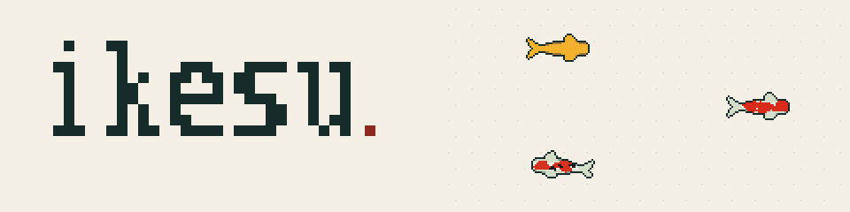

[English](README.md) | 日本語

**エージェントを池で育てる。**

AI のコーディングエージェントをたくさん並べて見守るための端末多重化ツール（terminal multiplexer）。手元と SSH 先の複数マシンのワークスペース・タブ・ペインを1つの画面にまとめて表示し、エージェント同士のメッセージ送信や、待たずに走らせる長時間ジョブを扱えます。

- 手元と SSH 先のマシンのスペースを1つのサイドバーに並べ、マウスやキーで行き来できる
- エージェントの状態（判断待ち・作業中・完了）をサイドバーと端末のタイトルに表示する
- `ikesu send` / `ikesu inbox` による消えないメッセージ、`ikesu run` による背景ジョブと完了通知
- サーバーを新しい版へ引き継いでも、動いているペインは止まらない（live handoff）
- macOS では、エージェントの判断待ちに答えるネイティブのパネルを使える
- サイドバーでエージェントの数だけピクセルアートの錦鯉が泳ぎ、エージェントの様子を見せる

仕様は [SPEC.md](SPEC.md) にあります。

## 対応環境

macOS（Apple Silicon・Intel）と Linux（arm64・amd64）。判断待ちパネルは Apple Silicon の macOS のみです。

## インストール

Homebrew で入れます。

```sh
brew install kazuph/tap/ikesu
ikesu --version
```

[GitHub Releases](https://github.com/kazuph/ikesu/releases) から各環境の実行ファイルを直接取得することもできます。

## 使い方

```sh
ikesu                      # 既定のセッションを開く（無ければ作る）
ikesu --session work       # 名前付きのセッションを開く
ikesu help                 # コマンドの一覧と使い方
```

prefix キーの既定は `ctrl+b` です。`prefix ?` でキー操作の一覧を表示します。

### エージェントを動かす

```sh
ikesu agent start reviewer -- claude          # ペインでエージェントを起動
ikesu send <pane> "テストを直して"             # エージェントへメッセージを送る
ikesu run --label tests -- go test ./...      # 待たずに走らせ、終わったら呼び出し元へ通知
ikesu log <job_id>                            # ジョブの結果を読む
```

### 複数のマシンをまとめる

```sh
ikesu machine add mini.local --label mini
ikesu machine list
```

追加したマシンのスペースはサイドバーに並びます。`keys.next_workspace` / `keys.previous_workspace`（例: `cmd+j` / `cmd+k`）は、マシンをまたいでスペースを順に移ります。相手のマシンも同じ版の ikesu が必要です。SSH の鍵や認証は OpenSSH の設定をそのまま使います。

### 判断待ちパネル（macOS）

```sh
ikesu mac-dialog install
ikesu mac-dialog status
```

エージェントの確認や質問を、ネイティブの窓で答えられるようにします。パネルはキーボードを奪いません。その質問を出したペインのスペースを今見ているときは、窓を背面に置きます。

## 錦鯉の池

右のサイドバーのエージェント一覧の下に空きがあると、サイドバーの背景のまま錦鯉が泳ぎます。鯉1匹がエージェント1体を表します。

- 作業中のエージェントの鯉は、池の中を自由に泳ぐ（深さがあるので、鯉どうしは重なって行き交う）
- 待機中のエージェントの鯉は、深く沈んで休む
- あなたの判断を待っているエージェントの鯉は、水面へ浮いて口をぱくぱくさせる
- 作業を終えたエージェントの鯉は、15秒間金色に光る

池の空いた所をクリックすると波紋が広がり、鯉が向きを変えてその場所へ集まります。作業中のエージェントがいるスペースの名前の横にも、小さな鯉が泳ぎます。エージェントが多いときは池が混み合わないように鯉の数を絞り、判断待ちのエージェントの鯉は必ず残します。

kitty の画像の仕組みに対応した端末（Ghostty・kitty・WezTerm）では、鯉の絵を一度だけ送り、その後は置き場所だけを動かします（SSH 越しでも同じです）。それ以外の端末では、同じ鯉を Unicode 16 の八分割文字で描きます（その文字を含むフォントが必要です）。

鯉の表示は、サイドバーの `[menu]` の `koi: on` / `koi: off` で切り替えられます。設定ファイルで切ることもできます。

```toml
[ui]
koi = false
```

サイドバーが閉じているときや、鯉を出していないときは、鯉のための描き直しをしません。ブランドサイトのソースは [site/index.html](site/index.html) です。

## 設定

設定ファイルは `~/.config/ikesu/config.toml` です（`IKESU_CONFIG` で変えられます）。

```toml
[keys]
prefix = "ctrl+t"
next_workspace = "cmd+j"
previous_workspace = "cmd+k"
switch_workspace = "cmd+1..9"
focus_history_back = "cmd+["
focus_history_forward = "cmd+]"
workspace_search = "cmd+f"
```

`workspace_search` はスペース検索を開くキーです。`prefix /` と、サイドバーの一番上の🔍でも開けるので、⌘の無い端末（Linux、Windows、スマホの SSH アプリ）では設定は要りません。`workspace_search = ["cmd+f", "alt+f"]` のように並べると、複数のキーを割り当てられます。

## 端末アプリの設定: ⌘のキーを ikesu へ届ける

ikesu は kitty キー符号（kitty keyboard protocol）を有効にするので、端末アプリは⌘の組み合わせを ikesu へ送れます。ただし端末アプリは、自分で使っている⌘のキーを ikesu へ送りません。`[keys]` に書いた⌘のキーは、端末アプリ側の割り当てを外してください。

### Ghostty

使うキーの行を設定ファイル（macOS では `~/Library/Application Support/com.mitchellh.ghostty/config` または `~/.config/ghostty/config`）に追記し、⌘⇧, で設定を読み直します。

```
# switch_workspace = "cmd+1..9"（Ghostty ではタブ1〜8・最後のタブへ移る）
keybind = super+1=unbind
keybind = super+digit_1=unbind
keybind = super+2=unbind
keybind = super+digit_2=unbind
keybind = super+3=unbind
keybind = super+digit_3=unbind
keybind = super+4=unbind
keybind = super+digit_4=unbind
keybind = super+5=unbind
keybind = super+digit_5=unbind
keybind = super+6=unbind
keybind = super+digit_6=unbind
keybind = super+7=unbind
keybind = super+digit_7=unbind
keybind = super+8=unbind
keybind = super+digit_8=unbind
keybind = super+9=unbind
keybind = super+digit_9=unbind
# focus_history_back / focus_history_forward = "cmd+[" / "cmd+]"（Ghostty では前・次の分割へ移る）
keybind = super+[=unbind
keybind = super+]=unbind
# workspace_search = "cmd+f"（Ghostty では検索を開く）
keybind = super+f=unbind
```

- 数字は `super+1` と `super+digit_1` の両方を外します。Ghostty が両方に割り当てているためです。
- ⌘J と ⌘K の行は要りません。Ghostty はこの2つを「選択した所へ移る」「画面を消す」に割り当てていますが、ikesu を表示している間はその操作をせず、キーを ikesu へ渡します。ただし Ghostty 自身の選択で文字を選んでいる間の ⌘J は、Ghostty が使います。
- 開いている Ghostty の窓は、設定を読み直すまで前の割り当てのままです。
- `ghostty +list-keybinds` で確かめられます。外したキーは一覧に出なくなります。
- この設定の後は、Ghostty 自体のタブ切替に ⌘⇧[ / ⌘⇧]、分割の移動に ⌘⌥＋矢印キーを使います。

### ⌘Tab は使えません

⌘Tab は macOS がアプリ切替のために先に取るため、どの端末アプリにも届きません。

## 端末アプリの設定: ⌃Tab / ⌃⇧Tab でタブを移動する

ikesu は既定で ⌃Tab を「次のタブ」、⌃⇧Tab を「前のタブ」に割り当てています（`prefix n` / `prefix p` も使えます）。ただし多くの端末アプリは ⌃Tab を自分のタブ切替に使うため、そのままでは ikesu までキーが届きません。端末アプリ側で、⌃Tab を kitty キー符号の文字列として送るように設定してください。

| キー | 端末から送る文字列 |
|---|---|
| ⌃Tab | `\x1b[9;5u` |
| ⌃⇧Tab | `\x1b[9;6u` |

### Ghostty

設定ファイル（macOS では `~/Library/Application Support/com.mitchellh.ghostty/config` または `~/.config/ghostty/config`）に追記し、⌘⇧, で設定を読み直します。

```
keybind = ctrl+tab=text:\x1b[9;5u
keybind = ctrl+shift+tab=text:\x1b[9;6u
```

- 割当を外すだけ（`keybind = ctrl+tab=unbind`）では足りません。macOS 標準のタブ（`macos-titlebar-style = tabs`）を使っていると、キーを押した信号がメニューの「次のタブを表示」に吸われ、離した信号だけが届きます。
- この設定の後は、Ghostty 自体のタブ切替に ⌘⇧[ / ⌘⇧] を使います。

### そのほかの端末

上の表の文字列を ⌃Tab / ⌃⇧Tab で送る設定にしてください。Ghostty 以外の端末の設定例はまだ検証していません。

## ライセンス

[MIT](LICENSE)

`ikesu agent start` は herdr と異なり、既定で現在の画面を切り替えません。新しいエージェントへ移るときは `--focus` を付けます。既存の `--no-focus` も使えます。明示的な focus API と通知クリックの動作は変わりません。


既定では全テーマで、メイン領域・サイドバー・タブバー・下部バーの背景が端末の背景を透かします。全体をテーマの背景色で塗る場合は、次の1項目を設定します。

```toml
[ui]
opaque_background = true
```

`[theme.custom] panel_bg` の明示指定はこの設定より優先し、全領域の共通背景へ適用します。`panel_bg` がなければ `surface_dim` を参照します。明示した `surface0` はカード・操作部品の面色として引き続き優先します。端末内のアプリが描く色は保持します。浮かぶメニュー・ダイアログ・ポップアップは、下の文字を隠して読みやすくするため背景を残します。
