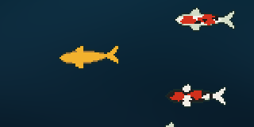

# ikesu

English | [日本語](README.ja.md)

**Raise your agents in a pond.**



A terminal multiplexer for watching many AI coding agents side by side. ikesu shows the workspaces, tabs and panes of your local machine and of SSH machines in one screen, and lets agents exchange messages and run long jobs without blocking.

- One sidebar for the spaces of the local machine and SSH machines; move between them with the mouse or keys
- Agent status (waiting for a decision, working, done) in the sidebar and the terminal title
- Durable messages with `ikesu send` / `ikesu inbox`, background jobs with completion notices via `ikesu run`
- Running panes keep going when the server is handed off to a new version (live handoff)
- On macOS, a native panel for answering agents' decisions
- Pixel-art koi swim in the sidebar, one for each agent, and show what the agents are doing

The specification is in [SPEC.md](SPEC.md) (Japanese).

## Platforms

macOS (Apple Silicon and Intel) and Linux (arm64 and amd64). The decision panel is available only on Apple Silicon macOS.

## Install

With Homebrew:

```sh
brew install kazuph/tap/ikesu
ikesu --version
```

Binaries for each platform are also available from [GitHub Releases](https://github.com/kazuph/ikesu/releases).

## Usage

```sh
ikesu                      # open the default session (created if missing)
ikesu --session work       # open a named session
ikesu help                 # commands and usage
```

The default prefix key is `ctrl+b`. Press `prefix ?` to list key bindings.

### Running agents

```sh
ikesu agent start reviewer -- claude          # start an agent in a pane
ikesu send <pane> "please fix the tests"      # send a message to an agent
ikesu run --label tests -- go test ./...      # run without waiting; the caller is notified on exit
ikesu log <job_id>                            # read the job result
```

### Combining machines

```sh
ikesu machine add mini.local --label mini
ikesu machine list
```

Spaces of added machines appear in the sidebar. `keys.next_workspace` / `keys.previous_workspace` (for example `cmd+j` / `cmd+k`) move through spaces across machines. The other machine needs the same ikesu version. SSH keys and authentication come from your OpenSSH configuration.

### Decision panel (macOS)

```sh
ikesu mac-dialog install
ikesu mac-dialog status
```

Lets you answer agents' confirmations and questions in a native window. The panel never takes the keyboard. While you are looking at the space of the pane that asked, the window is placed behind other windows.

## Koi pond

When there is room below the agent list in the right sidebar, koi swim there over the sidebar's own background. Each koi stands for an agent:

- Working agents swim freely across the pond; koi have depth, so they may pass over one another
- Idle agents sink deeper and rest
- Agents waiting for you come up to the surface and open their mouths
- Agents that just finished glow gold for 15 seconds

Click an empty part of the pond to send out a ripple; the koi turn and gather at that spot. A small koi also swims beside each space that has a working agent. When there are many agents, fewer koi are shown so the pond never gets crowded, and an agent waiting for you always keeps a koi.

On terminals that support the kitty graphics protocol (Ghostty, kitty, WezTerm), each koi image is sent once and only its position is updated afterwards, including over SSH. Other terminals show the same koi with Unicode 16 octant characters, which need a font that includes them.

Turn the koi on or off from `koi: on` / `koi: off` in the sidebar `[menu]`, or in the configuration file:

```toml
[ui]
koi = false
```

The koi stop redrawing when the sidebar is hidden or no koi are shown. The brand site source is [site/index.html](site/index.html).

## Configuration

The configuration file is `~/.config/ikesu/config.toml` (override with `IKESU_CONFIG`).

```toml
[keys]
prefix = "ctrl+t"
next_workspace = "cmd+j"
previous_workspace = "cmd+k"
switch_workspace = "cmd+1..9"
```

## Terminal setup: switch tabs with ⌃Tab / ⌃⇧Tab

By default ikesu binds ⌃Tab to "next tab" and ⌃⇧Tab to "previous tab" (`prefix n` / `prefix p` also work). Many terminal apps use ⌃Tab for their own tabs, so the key does not reach ikesu as is. Configure your terminal to send ⌃Tab as a kitty keyboard protocol sequence.

| Key | Sequence the terminal sends |
|---|---|
| ⌃Tab | `\x1b[9;5u` |
| ⌃⇧Tab | `\x1b[9;6u` |

### Ghostty

Add the following to the configuration file (on macOS, `~/Library/Application Support/com.mitchellh.ghostty/config` or `~/.config/ghostty/config`) and reload it with ⌘⇧,.

```
keybind = ctrl+tab=text:\x1b[9;5u
keybind = ctrl+shift+tab=text:\x1b[9;6u
```

- Unbinding alone (`keybind = ctrl+tab=unbind`) is not enough. With macOS native tabs (`macos-titlebar-style = tabs`), the key press is consumed by the "Show Next Tab" menu item and only the key release reaches the app.
- After this change, use ⌘⇧[ / ⌘⇧] to switch Ghostty's own tabs.

### Other terminals

Configure ⌃Tab / ⌃⇧Tab to send the sequences in the table above. Examples for terminals other than Ghostty have not been verified yet.

### ⌘Tab cannot be used

macOS takes ⌘Tab for app switching before any terminal app sees it.

## License

[MIT](LICENSE)
