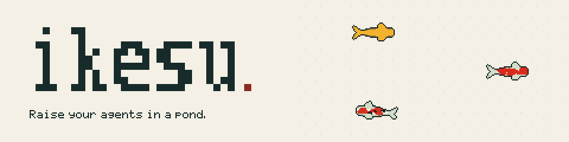

English | [日本語](README.ja.md)

A terminal multiplexer for watching many AI coding agents side by side. ikesu shows the workspaces, tabs and panes of your local machine and of SSH machines in one screen, and lets agents exchange messages and run long jobs without blocking.

- One sidebar for the spaces of the local machine and SSH machines; move between them with the mouse or keys
- Agent status (waiting for a decision, working, done) in the sidebar and the terminal title
- Durable messages with `ikesu send` / `ikesu inbox`, background jobs with completion notices via `ikesu run`
- Running panes keep going when the server is handed off to a new version (live handoff)
- On macOS, a native panel for answering agents' decisions
- Pixel-art koi swim in the sidebar, one for each agent, and show what the agents are doing

The specification is in [SPEC.md](SPEC.md) (Japanese).

## Platforms

macOS (Apple Silicon and Intel) and Linux (arm64 and amd64). The decision panel is available only on Apple Silicon macOS.

## Install

With Homebrew:

```sh
brew install kazuph/tap/ikesu
ikesu --version
```

Binaries for each platform are also available from [GitHub Releases](https://github.com/kazuph/ikesu/releases).

## Usage

```sh
ikesu                      # open the default session (created if missing)
ikesu --session work       # open a named session
ikesu help                 # commands and usage
```

The default prefix key is `ctrl+b`. Press `prefix ?` to list key bindings.

### Running agents

```sh
ikesu agent start reviewer -- claude          # start an agent in a pane
ikesu send <pane> "please fix the tests"      # send a message to an agent
ikesu run --label tests -- go test ./...      # run without waiting; the caller is notified on exit
ikesu log <job_id>                            # read the job result
```

### Combining machines

```sh
ikesu machine add mini.local --label mini
ikesu machine list
```

Spaces of added machines appear in the sidebar. `keys.next_workspace` / `keys.previous_workspace` (for example `cmd+j` / `cmd+k`) move through spaces across machines. The other machine needs the same ikesu version. SSH keys and authentication come from your OpenSSH configuration.

### Decision panel (macOS)

```sh
ikesu mac-dialog install
ikesu mac-dialog status
```

Lets you answer agents' confirmations and questions in a native window. The panel never takes the keyboard. While you are looking at the space of the pane that asked, the window is placed behind other windows.

### Sidebar plugins

Executable scripts in `~/.config/ikesu/plugins/sidebar/` run at the interval in their name (named like SwiftBar plugins). The lines they print before `---` are shown, with their ANSI SGR colors, at the bottom of the sidebar. Scripts receive the target sidebar's inner width in `IKESU_SIDEBAR_COLUMNS`.

With `config_version = 2` (the default for fresh configs), opt in from `~/.config/ikesu/config.toml`:

```toml
[ui.sidebar_plugins]
enabled = true
```

#### Placement and metadata

- Directory: `~/.config/ikesu/plugins/sidebar/` or `left/` (defaults to the left sidebar), or `right/` (defaults to the right sidebar)
- File name: `<name>.<number><unit>[.<ext>]` (`s`, `m`, `h`, `d`; must be executable via `chmod +x`)
- Comment metadata in the first 20 lines overrides folder placement, title, and sort order:

```sh
# ikesu.position = right   # left or right
# ikesu.title = Weather    # heading label (defaults to <name>)
# ikesu.order = 10         # sort order (ascending, default 0)
```

The folder is rescanned every 10 seconds, so adding, editing, or removing scripts takes effect without restarting. Intervals under 10 seconds run every 10 seconds, and a script still running after 10 seconds is stopped. Each plugin gets a heading; click it to fold.

#### Sample plugins

Ready-to-use samples live in [examples/sidebar-plugins/](examples/sidebar-plugins/):

| File | Side | Description |
|---|---|---|
| [resources.1m.sh](examples/sidebar-plugins/resources.1m.sh) | Left | macOS CPU usage (0–100%), memory, and disk bars plus 1m/5m/15m load averages |
| [weather.10m.py](examples/sidebar-plugins/weather.10m.py) | Right | Real-time weather, today's min/max temperature, and 2-hourly precipitation trend via Open-Meteo (defaults to Tokyo; override `LAT`/`LON` or `WEATHER_LAT`/`WEATHER_LON`) |
| [usage.30s.sh](examples/sidebar-plugins/usage.30s.sh) | Right | AI usage limit bars via AgentPal (`AgentPal usage`) |

```sh
mkdir -p ~/.config/ikesu/plugins/sidebar
cp examples/sidebar-plugins/resources.1m.sh examples/sidebar-plugins/weather.10m.py ~/.config/ikesu/plugins/sidebar/
chmod +x ~/.config/ikesu/plugins/sidebar/*
```

## Koi pond

When there is room below the agent list in the right sidebar, koi swim there over the sidebar's own background. Each koi stands for an agent:

- Working agents swim freely across the pond; koi have depth, so they may pass over one another
- Idle agents sink deeper and rest
- Agents waiting for you come up to the surface and open their mouths
- Agents that just finished glow gold for 15 seconds

Click an empty part of the pond to send out a ripple; the koi turn and gather at that spot. A small koi also swims beside each space that has a working agent. When there are many agents, fewer koi are shown so the pond never gets crowded, and an agent waiting for you always keeps a koi.

On terminals that support the kitty graphics protocol (Ghostty, kitty, WezTerm), each koi image is sent once and only its position is updated afterwards, including over SSH. Other terminals show the same koi with Unicode 16 octant characters, which need a font that includes them.

Turn the koi on or off from `koi: on` / `koi: off` in the sidebar `[menu]`, or in the configuration file:

```toml
[ui]
koi = false
```

The koi stop redrawing when the sidebar is hidden or no koi are shown. The brand site source is [site/index.html](site/index.html).

## Phone app (Android)

The Android app shows ikesu's decisions as notifications, answers them, and opens the PC's ikesu screen on the phone. The phone and the PC talk through a small relay on Cloudflare Workers, encrypted end to end; the relay cannot read what passes through it.

Each user deploys their own relay to their own Cloudflare account:

[](https://deploy.workers.cloudflare.com/?url=https://github.com/kazuph/ikesu/tree/main/apps/relay)

1. Make a relay key: `node -e 'console.log(require("crypto").randomBytes(32).toString("base64url"))'`
2. Press the button, paste the key into `RELAY_KEY`, and deploy.
3. On the PC: `node apps/android/bridge/main.mjs relay-setup --url wss://ikesu-relay.<your-subdomain>.workers.dev --key <the key>`
4. Pair the phone: `node apps/android/bridge/main.mjs pair --name <PC name>` and scan the QR code with the app.

Details (Japanese): [apps/relay](apps/relay/README.md), [apps/android](apps/android/README.md).

## Configuration

The configuration file is `~/.config/ikesu/config.toml` (override with `IKESU_CONFIG`).

```toml
[keys]
prefix = "ctrl+t"
next_workspace = "cmd+j"
previous_workspace = "cmd+k"
switch_workspace = "cmd+1..9"
focus_history_back = "cmd+["
focus_history_forward = "cmd+]"
workspace_search = "cmd+f"
```

`workspace_search` opens the space search. `prefix /` and the 🔍 at the top of the sidebar also open it, so terminals without ⌘ (Linux, Windows, SSH apps on phones) need no setup. A list such as `workspace_search = ["cmd+f", "alt+f"]` binds several keys.

`[remote] auto_disconnect_after` controls how long a saved SSH machine may stay unreachable before ikesu disconnects it. Set it to a duration such as `"10m"`. The default `0` keeps the usual retries. After the deadline, ikesu saves the machine as disconnected and shows the last connection error, when available. Use `[connect]` in the sidebar or `ikesu machine connect <label-or-id>` to try again.

## Terminal setup: let ⌘ keys reach ikesu

ikesu turns on the kitty keyboard protocol, so the terminal can pass ⌘ combinations to it. A terminal app sends a ⌘ key only when it does not use the key itself. Remove the terminal's own binding for every ⌘ key you put in `[keys]`.

### Ghostty

Add the lines for the keys you use to the configuration file (on macOS, `~/Library/Application Support/com.mitchellh.ghostty/config` or `~/.config/ghostty/config`) and reload it with ⌘⇧,.

```
# switch_workspace = "cmd+1..9" (Ghostty: go to tab 1-8, last tab)
keybind = super+1=unbind
keybind = super+digit_1=unbind
keybind = super+2=unbind
keybind = super+digit_2=unbind
keybind = super+3=unbind
keybind = super+digit_3=unbind
keybind = super+4=unbind
keybind = super+digit_4=unbind
keybind = super+5=unbind
keybind = super+digit_5=unbind
keybind = super+6=unbind
keybind = super+digit_6=unbind
keybind = super+7=unbind
keybind = super+digit_7=unbind
keybind = super+8=unbind
keybind = super+digit_8=unbind
keybind = super+9=unbind
keybind = super+digit_9=unbind
# focus_history_back / focus_history_forward = "cmd+[" / "cmd+]" (Ghostty: previous / next split)
keybind = super+[=unbind
keybind = super+]=unbind
# workspace_search = "cmd+f" (Ghostty: search)
keybind = super+f=unbind
```

- Remove both forms of each digit (`super+1` and `super+digit_1`). Ghostty defines both.
- ⌘J and ⌘K need no line. Ghostty binds them to "scroll to selection" and "clear screen", but skips them while ikesu is on screen and passes the key on. ⌘J still goes to Ghostty while text is selected with Ghostty's own selection.
- A Ghostty window that is already open keeps the old bindings until the configuration is reloaded.
- Check the result with `ghostty +list-keybinds`. The keys you removed no longer appear in the list.
- After this change, use ⌘⇧[ / ⌘⇧] for Ghostty's own tabs and ⌘⌥ + arrow keys for its splits.

### ⌘Tab cannot be used

macOS takes ⌘Tab for app switching before any terminal app sees it.

## Terminal setup: switch tabs with ⌃Tab / ⌃⇧Tab

By default ikesu binds ⌃Tab to "next tab" and ⌃⇧Tab to "previous tab" (`prefix n` / `prefix p` also work). Many terminal apps use ⌃Tab for their own tabs, so the key does not reach ikesu as is. Configure your terminal to send ⌃Tab as a kitty keyboard protocol sequence.

| Key | Sequence the terminal sends |
|---|---|
| ⌃Tab | `\x1b[9;5u` |
| ⌃⇧Tab | `\x1b[9;6u` |

### Ghostty

Add the following to the configuration file (on macOS, `~/Library/Application Support/com.mitchellh.ghostty/config` or `~/.config/ghostty/config`) and reload it with ⌘⇧,.

```
keybind = ctrl+tab=text:\x1b[9;5u
keybind = ctrl+shift+tab=text:\x1b[9;6u
```

- Unbinding alone (`keybind = ctrl+tab=unbind`) is not enough. With macOS native tabs (`macos-titlebar-style = tabs`), the key press is consumed by the "Show Next Tab" menu item and only the key release reaches the app.
- After this change, use ⌘⇧[ / ⌘⇧] to switch Ghostty's own tabs.

### Other terminals

Configure ⌃Tab / ⌃⇧Tab to send the sequences in the table above. Examples for terminals other than Ghostty have not been verified yet.

## Architecture

ikesu is one Go binary (`cmd/ikesu`). The same binary runs as the server, as a display client, and as the CLI that agents call.

```text
 terminal ─ ikesu (client) ─┐  ikesu-client.sock
 terminal ─ ikesu (client) ─┤
                            ├──▶ ikesu server ──┬── PTY ── shell / claude / codex …
 agents ─ ikesu send/run …──┘  ikesu.sock       ├── PTY ── …
                                                └── plugins (mac panel, Slack, Android bridge)
 the client also runs "ssh <target> ikesu __endpoint" to show an SSH machine's spaces in the same sidebar
```

### Server, clients and sessions

- `ikesu` with no subcommand attaches a client to a session (`default` unless `--session`). The first client starts the server in the background. `--no-session` runs a standalone UI without a server.
- Each session keeps its state in `~/.local/state/ikesu/<session>/` (or `$IKESU_STATE_DIR`): `ikesu.sock` for the API (one JSON request and response per line), `ikesu-client.sock` for display clients, a lock, `server.log` and `session.json`.
- The server owns the model and the PTYs. It keeps one viewer per client (`internal/tui`), so each client has its own focus, space and sidebar. The server sends each client a diff-encoded snapshot of what to draw, and the client composes the frame and writes it to its terminal (`internal/endpoint`, `internal/render`).
- `internal/retained` re-executes the server from a private, versioned copy of the binary, so Homebrew can replace the installed binary while the server runs.

### Panes and terminal emulation

- `internal/runtime` owns everything with side effects: PTYs, child processes and the terminal emulators. The emulator is `charmbracelet/x/vt`, vendored in `third_party/vt`.
- Scrollback has a byte budget per pane (`[advanced] scrollback_limit_bytes`). Saved history is only replayed for display, never run again.
- `internal/model` holds workspaces ("spaces"), their tabs and panes; `internal/layout` is the split tree. `internal/session` writes `session.json` atomically: spaces, tabs, splits, working directories and each pane's agent session id. The server saves it shortly after each change and restores it at start.

### Live handoff (upgrading without stopping panes)

`ikesu server live-handoff` starts the new binary with `server --handoff-import` and passes it the listening sockets, the lock and every PTY as open file descriptors. After checking the new server's protocol and version, the old server sends the whole state and exits; on failure it rolls back. Shells and agents keep running. `scripts/ikesu-upgrade.sh` installs a release with Homebrew, keeps a versioned copy, and hands each session over to it.

### Machines over SSH

`ikesu machine add <ssh-target> --label <name>` saves an SSH machine (`internal/machine`). The client runs `ssh <target> ikesu __endpoint`, which connects to the server already running there, and shows those spaces next to the local ones. `--machine <name>` forwards `agent`, `pane`, `workspace` and `worktree` commands to that machine.

### Agents, messages and jobs

- `internal/detect` recognises agents (Claude Code, Codex, Gemini and about 20 more) from the process and the screen, using the TOML manifests in `internal/detect/manifests`, and marks each pane idle, working or blocked. The sidebar and the terminal title show this.
- `internal/dispatch` keeps one SQLite database (`ikesu.db`, WAL) per session for messages, jobs, the pane-to-agent-session ledger and decisions.
- `ikesu send` / `ikesu inbox` deliver durable messages: the server types the message into the target pane and records the delivery.
- `ikesu run` starts a background job with its own log and sends one completion notice to the caller. `ikesu log` and `ikesu run list` read the database directly, so they work without the server.

### Decisions (an agent waiting for a person)

- A decision is created from three places: a question screen that ikesu reads in a Claude Code or Codex pane (`internal/screenprompt`, `[decisions] screen_prompts`), an explicit `ikesu decision ask`, or a command that the guard wants a person to approve.
- `ikesu decision watch` streams new and resolved decisions; `ikesu decision answer` answers one. An answer to a question screen is typed back into the pane.
- Answering front ends are plugins that watch decisions: the macOS panel (`apps/mac-dialog-decisions`), Slack (`apps/slack-decisions`) and the Android app (`apps/android`).

### Guard

`internal/guard` checks the commands that agents run before they run. It hooks agent shells (generated startup files, PATH shims, a Claude Code hook), parses shell, git, GitHub, SQL and HTTP commands without running them, and allows, blocks, or asks. An ask becomes a decision with a tier: L1 local only, L2 a known development destination, L3 production, irreversible or unknown. Verdicts go to an audit log (`ikesu guard log`). Settings are under `[guard]`.

### Plugins

A plugin is a directory with `ikesu-plugin.toml` (id, version, events such as `decision.created`, actions). `ikesu plugin link <dir>` or `ikesu plugin install <owner>/<repo>[/subdir]` registers it in `~/.config/ikesu/plugins.json`. The server runs the plugin's command for each event with `IKESU_PLUGIN_*`, `IKESU_SOCKET_PATH` and `IKESU_BIN_PATH` set, and the plugin talks back through the CLI.

### The phone app (Android)

```text
 phone app ⇄ wss ⇄ relay (your Cloudflare Worker, one Durable Object per room) ⇄ wss ⇄ bridge (Node, on the PC) ⇄ ikesu
          └──────────── Noise IK, end to end: the relay only passes ciphertext ────────────┘
```

- The relay (`apps/relay`) checks an HMAC tag made with `RELAY_KEY`, joins one bridge and up to 4 phones per room, and enforces size and rate limits. It holds no Noise keys.
- The bridge (`apps/android/bridge`) runs as an `ikesu run` job, started by the `kazuph.android` plugin. It watches decisions and sends the phone only the titles until the phone proves a person is there.
- Pairing: `bridge/main.mjs pair` shows a QR code (valid 5 minutes); the phone and the PC show the same 6 digits derived from the handshake. The phone's keys go into `devices.json` with permissions (notify, answer, screen, input).
- To answer or to use the PC's screen, the phone signs the handshake with a key in the Android Keystore that needs a face or fingerprint. That opens a 10-minute window that each action extends. A heartbeat every 5 seconds lets the bridge drop old key input.
- The PC's screen: the bridge starts a nested `ikesu` client in a PTY at the phone's size, with a copy of your config that hides the sidebar (F12 shows it) and turns on `native_menus`. With `native_menus`, ikesu announces its menus and dialogs as `OSC 7767` escape sequences, and the app shows them as native Android lists and dialogs. Key input, taps (SGR mouse) and files go back the same way.
- Details: `apps/android/PROTOCOL.md`.

### Code map

| Path | Role |
|---|---|
| `cmd/ikesu` | entry point and subcommand dispatch |
| `internal/server` | the session server: clients, persistence, handoff, jobs, mail, decisions, plugin events |
| `internal/client`, `internal/endpoint` | the display client, SSH endpoints and the snapshot transport |
| `internal/tui`, `internal/render` | the UI loop, per-client viewers, and drawing (sidebar, tabs, dialogs, koi pond) |
| `internal/runtime` | PTYs, processes, terminal emulation, scrollback |
| `internal/model`, `internal/layout`, `internal/session` | spaces, tabs, split trees, `session.json` |
| `internal/detect`, `internal/screenprompt` | agent status and question screens |
| `internal/dispatch` | the SQLite store for messages, jobs and decisions |
| `internal/guard` | command checks for agents |
| `internal/plugin`, `internal/machine`, `internal/config` | plugins, SSH machines, `config.toml` |
| `apps/` | the macOS panel, Slack, the Android app and bridge, the relay |

## License

[MIT](LICENSE)

`ikesu agent start` keeps the current view by default, unlike herdr. Use `--focus` to switch to the new agent; `--no-focus` is still accepted. Explicit focus APIs and notification clicks keep their existing behavior.


The default background is transparent in every theme, including panes, sidebars, tabs and the bottom bar. To fill the whole interface with the selected theme's background:

```toml
[ui]
opaque_background = true
```

Explicit `[theme.custom] panel_bg` colors override this switch for the common background, with `surface_dim` as the fallback. Explicit `surface0` component colors retain priority for cards and controls. Application-drawn terminal colors remain intact. Floating menus, dialogs and popups keep a background to hide underlying text.
