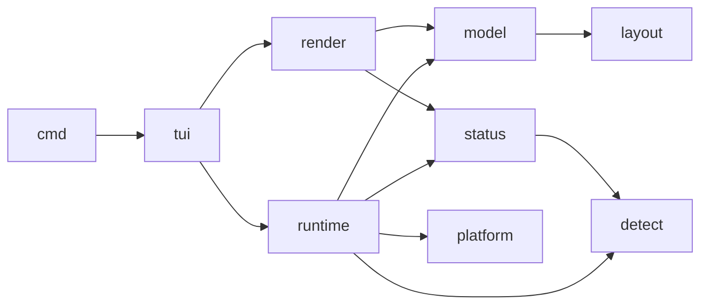

# moonterrace 実装計画 第1段階（サイドバー・マルチペイン・エージェント進捗）

この文書は実装担当（Devin SWE-2 High）への指示書です。上から順に読み、マイルストーンの順に実装してください。
書かれていない機能は作らないでください。迷ったら「計画で決まっていること」を優先し、決まっていなければ親へ報告してください。

## 0. 何を作るか

moonterrace は、AI コーディングエージェント（Claude Code・Codex・Devin など）を複数並べて動かすための
端末アプリです。コマンド名は `mt` です。店長（ユーザー）が普段使っている herdr（Rust 製）の fork
`~/src/github.com/kazuph/herdr` の設計方針を守りつつ、MoonBit でゼロから書きます。herdr のコードを
1行ずつ移植（ポート）するのではありません。herdr は「どう動くべきか」の参考です。

第1段階で作るのは次の3つだけです。

1. **マルチペイン**: 1つのワークスペースの中で画面を縦・横に分割し、それぞれでシェルを動かす。
2. **サイドバー**: 画面左にワークスペース一覧と、各ワークスペースで動いているエージェントの状態を出す。
3. **エージェント進捗管理**: 各ペインで動いているのがどのエージェントかを見分け、
   「作業中・入力待ち（ブロック）・完了（未確認）・待機・不明」を画面から判定してサイドバーに出す。

完成イメージ（幅 100 × 高さ 20 の例）:

```
┌ workspaces ─────────────┐┌ 1 claude ─────────────────────────┐┌ 2 zsh ───────────────────────────┐
│ 1 ▲ moonterrace         ││ > 調べて                          ││ ~/src $ ls                        │
│     claude   blocked    ││                                   ││ a b c                             │
│     codex    working ◐  ││ Do you want to proceed?           ││ ~/src $ █                         │
│ 2 ● herdr               ││ ❯ 1. Yes                          ││                                   │
│     devin    done       ││                                   ││                                   │
│ 3 ○ notes               ││                                   ││                                   │
└─────────────────────────┘└───────────────────────────────────┘└───────────────────────────────────┘
 mt  prefix: C-b   workspace 1/3                                                          ◐ 1  ▲ 1  ● 1
```

## 1. 守る設計方針（herdr fork `AGENTS.md` の Principles から。必ず守る）

- **状態とランタイムを分ける**: アプリの状態（ワークスペース・ペインの並び・エージェント状態）は
  PTY も非同期処理も持たない純粋なデータにする。PTY・端末エンジン・子プロセスはランタイム側に置く。
  状態のテストは PTY なしで書けること。
- **描画は純粋**: 描画関数は状態を読むだけで、状態を書き換えない。描画結果は「文字列（端末へ出すバイト列）」
  として返し、出力はその外側で行う。
- **巨大なモジュールを作らない**: 1ファイル 800 行を超えそうなら分ける。
- **OS 依存コードは隔離**: macOS / Linux の違いは `src/platform/` の C スタブとその MoonBit ラッパーだけに置く。
- **検出は画面だけを見る**: エージェント状態の判定は「画面の文字のスナップショット」と OSC タイトル
  （端末タイトル）だけを入力にする。フック（エージェント側からの通知）は使わない。スクロールして見ている
  位置（ビューポート）ではなく、実際の画面の最下部を使う。
- **サーバーとクライアントの境界を意識する**: herdr は「サーバーが PTY と状態を持ち、TUI はその表示役の
  1クライアント」という形へ移行中です。第1段階は1プロセスで動かしますが、`runtime` と `tui` の間は
  後でソケットに置き換えられるよう、**メッセージ（コマンドとスナップショット）の型で受け渡す**。
  サイドバー・行・色のような表示用の名前を `model` / `runtime` 側の型名に入れない。

## 2. 決まっていること（変えない）

| 項目 | 決定 |
|---|---|
| 言語・対象 | MoonBit、native ターゲットのみ（`supported_targets = "native"`） |
| ツールチェーン | `moon 0.1.20260920` 以降（確認済み） |
| 端末エンジン | `tonyfettes/ghostty@0.4.0` の `terminal` パッケージ（Ghostty を MoonBit に移植したもの。Zig 不要） |
| PTY | `moonbit-community/pty@0.4.3`（`@pty.spawn`） |
| 外側の端末操作 | `moonbit-community/tty@0.4.0`（raw mode・サイズ取得・キー/マウス入力） |
| 非同期 | `moonbitlang/async@0.22.4` |
| 正規表現 | `moonbitlang/regexp@0.3.5`（制約あり。5章） |
| TOML | `moonbit-community/toml@0.5.0`（エージェント検出ルールの読み込み） |
| ライセンス | MIT（`LICENSE` 済み）。tonyfettes/ghostty の例のコードを流用した場合は `NOTICE` に Apache-2.0 の出典を書く |
| prefix キー | `Ctrl-b`（店長の herdr は `Ctrl-t` なので重ならない） |
| 設定ファイル | 第1段階では作らない（キーは固定） |
| タブ | 第1段階では作らない（ワークスペース1つ＝ペイン分割1つ） |
| デタッチ・永続化 | 第1段階では作らない |

`moon.mod` は親が作成済みです。依存の版を変えないでください。

## 3. 参考にしてよいもの

- herdr fork（読むだけ。編集しない）: `~/src/github.com/kazuph/herdr`
  - 設計方針: `AGENTS.md`
  - BSP レイアウト: `src/layout.rs`（`Node::Pane / Node::Split`、`ratio`、方向ナビゲーション）
  - 状態の型と判定: `src/detect/mod.rs`（`AgentState`、`identify_agent`）、`src/detect/manifest.rs`（ルールの評価）
  - 状態遷移の安定化: `src/pane/agent_detection.rs`（作業中→待機の確認待ち）
  - サイドバーの注目度: `src/ui/sidebar.rs` の `agent_panel_status_key` と `workspace_attention_priority`
  - 検出ルール（22 エージェント分）: `src/detect/manifests/*.toml` → **moonterrace の `src/detect/manifests/` へそのままコピーして使う**（店長が MIT での利用を了承済み）
  - 既定キー: `src/config/model.rs` の `Default:` コメント
- MoonBit 版 Ghostty（読むだけ）: `~/src/github.com/moonbit-community/tonyfettes-ghostty`
  - `examples/tmux/main.mbt` … PTY と StreamTerminal と tty を組み合わせた小さな tmux。raw mode・入力・
    ペイン描画・リサイズの書き方の手本。必要部分を書き写してよい（その場合 `NOTICE` に出典を書く）
  - `terminal/pkg.generated.mbti` … 端末エンジンの公開 API 一覧
- 親が動かして確認済みの試作: `docs/spike/`（`main.mbt.txt`: PTY→StreamTerminal→画面テキスト・正規表現の確認、`proc.c`: macOS の前面プロセス取得、`moon.pkg.txt`: C スタブの指定方法）。ビルド対象にならないよう拡張子を変えてある。

API が分からないときは推測せず、`moon doc '<Type>'`、`moon ide peek-def`、`.mooncakes/` 内の
`pkg.generated.mbti` を見て確かめてください。

## 4. パッケージ構成

```
moonterrace/
  moon.mod
  cmd/mt/            main（引数解析と起動だけ）
  src/model/         純粋な状態: Workspace, PaneId, AppState, Command
  src/layout/        純粋な BSP レイアウト
  src/detect/        純粋な検出: Agent 識別, ルール読み込み, 正規表現変換, ルール評価
    manifests/       herdr fork からコピーした *.toml（22 個）
  src/status/        純粋な状態機械: 作業中→待機の確認待ち, 未確認フラグ, 注目度, 集計
  src/platform/      C スタブ（前面プロセス）と MoonBit ラッパー
  src/runtime/       PTY + StreamTerminal + 検出ループ（ペインの実体）
  src/render/        純粋な描画: AppState と画面スナップショット → 端末へ出すバイト列
  src/tui/           外側の端末: raw mode, 入力の解釈, 描画ループ
  tests/e2e/         実 PTY を使う結合テスト
```

依存の向き（逆向きの import は禁止）:



`model`・`layout`・`detect`・`status`・`render` は native 専用 API（PTY・ファイル・C スタブ）を import しない。
ただし `detect` が同梱ルールを文字列として持つのはよい（5.3）。

## 5. 各パッケージの仕様

### 5.1 layout（BSP ツリー）

```moonbit
pub(all) enum Direction { Horizontal; Vertical }   // Vertical = 左右に並べる（herdr の split_vertical）, Horizontal = 上下に積む
pub(all) struct Rect { x : Int; y : Int; w : Int; h : Int } derive(Eq, Show)
pub(all) enum Node { Leaf(Int); Split(Direction, Double, Node, Node) }   // Double = 1つ目の子の比率 0.1〜0.9
pub struct Layout { root : Node; focus : Int; order : Array[Int] }       // order = 作成順のペイン ID
```

関数（すべて純粋。新しい Layout を返すか、自分を書き換えるかはどちらでもよいが統一する）:

- `Layout::new(root_pane : Int)`
- `split_focused(dir, new_pane : Int)` … フォーカス中のペインを 0.5 で分割し、新ペインを2つ目の子に置き、フォーカスを新ペインへ移す
- `close(pane : Int) -> Bool` … 葉を消し、兄弟を親の位置に繰り上げる。最後の1枚は消せない（false）。フォーカスは兄弟側の最初の葉へ
- `panes(area : Rect) -> Array[(Int, Rect)]` … 各ペインの外枠。比率で分け、端数は2つ目の子に足す。罫線1文字分の扱いは render 側で行う
- `focus_dir(dir : NavDir, area : Rect)` … 上下左右の隣へ。隣接判定は「辺が接していて、直交方向に重なりがある」中で、フォーカス中ペインの中心に最も近いもの
- `cycle(next : Bool)` … `order` の順で次/前へ
- `pane_ids() -> Array[Int]`

テスト（`layout_test.mbt`）: 分割→座標、3分割の座標、close の繰り上げ、最後の1枚は消せない、
左右上下の移動、幅が奇数のときの端数、`cycle` の一周。

### 5.2 model（アプリ状態）

```moonbit
pub struct Workspace { id : Int; mut name : String; cwd : String; layout : @layout.Layout }
pub struct AppState {
  workspaces : Array[Workspace]
  mut active : Int            // workspaces の添字
  mut sidebar_visible : Bool
  mut next_pane_id : Int
  mut next_workspace_id : Int
}
pub(all) enum Command {       // UI からランタイムへの要求。後でソケットに載せる前提で、データだけを持つ
  NewWorkspace(cwd~ : String)
  CloseWorkspace(Int)
  SelectWorkspace(Int)
  SplitFocused(@layout.Direction)
  ClosePane(Int)
  FocusPane(Int)
  FocusDir(@layout.NavDir)
  CyclePane(Bool)
  ToggleSidebar
  Resize(cols~ : Int, rows~ : Int)
  Input(pane~ : Int, bytes~ : Bytes)
  Quit
}
```

- ワークスペース名の既定は `cwd` の末尾のディレクトリ名。
- ペイン ID はアプリ全体で一意（ワークスペースをまたいでも重ならない）。
- `AppState::apply(cmd) -> Array[Effect]` のように、状態変更と「ランタイムにやってほしいこと
  （ペインを起動・終了・リサイズ）」を分けて返す形にする。状態変更はここだけで行う。
- テスト: 新規ワークスペース、分割、閉じる（ペインが0になったらワークスペースも閉じる。最後のワークスペースの
  最後のペインを閉じたら `Quit` 相当の Effect）、ワークスペース切替、ID が一意。

### 5.3 detect（どのエージェントか・画面から状態を判定）

**エージェントの識別**: 前面プロセス名（5.6 で取得）から判定する。herdr の `parse_agent_label` と同じ対応表
（`claude`→Claude、`codex`→Codex、`devin`→Devin … 22 種）を移す。`node` などの包み込みプロセスは
第1段階では引数（argv）まで見なくてよいが、`claude` が `node` 経由で起動される環境がありうるので、
5.6 の C スタブでは argv[0] の basename も返し、名前で見つからなければ argv[0] で再判定する。

**ルールファイル**: `src/detect/manifests/*.toml` は herdr fork からコピー。ビルド時にファイルを読めない
ので、`moon` のプリビルド等を使わず、**各 TOML の中身を MoonBit の複数行文字列（`#|`）として埋め込んだ
`manifests_bundled.mbt` を生成するスクリプト** `scripts/gen_manifests.py` を用意し、生成物もコミットする。
テストで「埋め込み文字列＝ toml ファイルの中身」を確認する。

**ルールの意味**（herdr の `manifest.rs` と同じ。必ず読んで合わせる）:

- 各ルール: `id`, `state`（idle / working / blocked / unknown）, `priority`（大きいほど優先）, `region`,
  ゲート（`contains`・`regex`・`line_regex`・`all`・`any`・`not`）, `visible_idle` / `visible_working` /
  `visible_blocker`, `skip_state_update`
- `contains`: 小文字化した領域テキストに、小文字の文字列がすべて含まれる
- `regex`: 領域テキスト全体に対してすべて一致
- `line_regex`: それぞれの正規表現について、領域のいずれかの行が一致
- `all`: 入れ子ゲートがすべて一致 / `any`: どれか一致（空なら無条件）/ `not`: どれか一致したら不一致
- 一致したルールのうち `priority` 最大のものを採用。なければ Idle。
- 領域（region）は第1段階でこれを全部実装する: `whole_recent`, `bottom_lines(N)`, `bottom_non_empty_lines(N)`,
  `osc_title`, `osc_progress`, `after_last_prompt_marker`, `after_last_horizontal_rule`, `prompt_box_body`,
  `last_non_empty_above_prompt_box`, `above_prompt_box`。定義は `manifest.rs` の同名関数を読んで同じ結果にする。
  未知の領域名はルール読み込み時にエラー。

**正規表現の変換（重要。親が試作で確認した `moonbitlang/regexp` の制約）**:

| herdr のルールでの書き方 | moonbitlang/regexp | 変換方法 |
|---|---|---|
| `\x{2800}` | 使えない（文字クラス内でエラー） | `\u{2800}` に置換 |
| `(?i)` を先頭に付ける | 使えない | パターンの「エスケープでない文字」を小文字化し、対象テキストも小文字化して照合。`\S` `\W` `\D` `\B` `\P{..}` など大文字のエスケープは小文字化しない |
| `(?m)` | 使えない。`^` `$` は**テキスト全体の先頭・末尾にしか一致しない**（試作で確認） | `^` が先頭にある場合は「各行の先頭から始まる部分文字列」それぞれに照合。文字クラス外のエスケープされていない `$` は `(?:\n|$)` に置換（一致の有無しか使わないので改行を消費してよい） |
| `\s` `\S` `\d` `\w` `\b` `\t` `\n` `\p{L}` `(?:...)` `{0,3}` `*?` | 使える（確認済み） | そのまま |

この変換は `detect/regex_compat.mbt` に1つの関数 `compile_compat(pattern : String) -> CompiledPattern raise`
としてまとめ、**全 22 ファイルの全パターンが読み込みでエラーにならないことをテストで保証する**。
変換できないパターンがあれば、そのルールだけ無効にして警告を返す（黙って一致扱いにしない）。

**判定関数**:

```moonbit
pub struct DetectionInput { screen : String; osc_title : String; osc_progress : String }
pub struct Detection { state : AgentState; visible_idle : Bool; visible_working : Bool; visible_blocker : Bool; skip_state_update : Bool; rule_id : String? }
pub fn detect(agent : Agent?, input : DetectionInput) -> Detection   // agent が None なら Unknown
```

テスト（フィクスチャは `src/detect/fixtures/<agent>_<state>.txt`）:

- 少なくとも claude・codex・devin について idle / working / blocked の画面を**実物から**採取する。
  採取方法: 同じ herdr タブに動いている各エージェントの pane で
  `herdr agent read <pane> --source detection --format text` を実行して保存する（読むだけ。相手の pane に入力しない）。
  見つからない状態（例: blocked）は、moonterrace を自分で動かしてその中で再現して採取してもよい。
  個人情報（ユーザー名・パス・会話内容）は `user` `~/project` `…` などに置き換える。
- 各フィクスチャで期待状態になること、`osc_title` だけで working になる claude のケース、
  `(?i)` `(?m)` `\x{}` を含むルールが正しく一致・不一致になること。

### 5.4 status（状態の安定化・未確認・注目度）

```moonbit
pub(all) enum AgentState { Idle; Working; Blocked; Unknown }
pub struct PaneStatus { agent : Agent?; state : AgentState; seen : Bool; changed_at_ms : Int64; /* 確認待ち用の内部値 */ }
```

- **作業中→待機の確認待ち**: 直前が Working で、次の判定が「visible_idle ではない Idle」のときは、
  すぐに Idle にせず、100ms 間隔で3回連続 Idle、または 700ms 経過した時点で Idle にする（herdr の
  `PendingIdleConfirmation` と同じ数値）。visible_idle / visible_blocker / エージェント変化 / プロセス終了なら即時。
- **起動直後の猶予**: エージェントを識別してから 3 秒は Unknown→Idle への確定を急がない（herdr の
  `AGENT_STARTUP_GRACE_WINDOW`）。
- **seen（確認済み）**: Working または Blocked → Idle に変わった瞬間に `seen = false`（＝「完了・未確認」）。
  そのペインがフォーカスされ、かつそのワークスペースが表示中になったら `seen = true`。
- **表示用の状態キー**（herdr と同じ）: Idle+未確認=`done`、Idle+確認済み=`idle`、Working=`working`、Blocked=`blocked`、Unknown=`unknown`
- **注目度**: blocked 4 > done 3 > working 2 > idle 1 > unknown 0。ワークスペースの状態は中のペインの最大値。
- **skip_state_update** のルールに一致した画面（履歴ビューアなど）では状態を変えない。
- テスト: 確認待ちの3回・700ms、即時遷移の各条件、seen の付け外し、注目度の集計、skip。時間は引数で渡す（現在時刻を内部で読まない）。

### 5.5 runtime（ペインの実体）

- `PaneRuntime`: `@pty.spawn` で `$SHELL`（なければ `/bin/zsh`）を `-l` 付きで、ワークスペースの `cwd` で起動。
  環境変数 `MOONTERRACE=1` と `MOONTERRACE_PANE_ID=<id>` を追加、`TERM=xterm-256color`。
- 読み取りタスク: `read_some()` のバイトを `StreamTerminal::next_slice` へ。端末からの応答（デバイス属性の問い合わせ等）は
  `StreamTerminal::new(write_pty=...)` で PTY に書き戻す（tmux 例の `flush_replies` を参照）。
  出力が来たら「画面が変わった」印を立て、描画を要求する。
- リサイズ: 外枠から罫線を引いた内側のサイズで `pty.resize` と `StreamTerminal::resize` を両方呼ぶ。
- **検出ループ**（ペインごと、250ms ごと）:
  1. 1000ms ごとに前面プロセスを調べる（5.6）。名前→Agent。変わったら即時判定。
  2. 画面が変わっていれば、**アクティブ画面の可視行**（スクロールバックや利用者のスクロール位置ではない）を
     行ごとにテキスト化（行末の空白は削る）して `DetectionInput.screen` にする。OSC タイトルは
     `StreamTerminal` の title（`title_changed` コールバックで更新を受け取る）。
  3. `detect` → `status` で安定化 → 変化があれば UI へ通知。
- ランタイムから UI へは「スナップショット」を渡す: 各ペインの StreamTerminal（描画用）と PaneStatus。
  UI はそれを読むだけ。

### 5.6 platform（前面プロセス）

試作の `proc.c` を元に `src/platform/proc.c` を作る。

- `mt_fg_pgid(shell_pid) -> Int`: macOS は `proc_pidinfo(PROC_PIDTBSDINFO)` の `e_tpgid`、Linux は `/proc/<pid>/stat` の第8項目（tpgid）。失敗は -1。
- `mt_proc_name(pid) -> Bytes`: macOS `proc_name`、Linux `/proc/<pid>/comm`。
- `mt_proc_argv0(pid) -> Bytes`: macOS `sysctl(KERN_PROCARGS2)`、Linux `/proc/<pid>/cmdline` の先頭。basename だけ返す。
- OS の分岐は C の `#ifdef __APPLE__` / `__linux__` の中だけ。MoonBit 側は `platform.mbt` で `extern "c"` を包む。
- テスト: 自分の PID で名前が取れる、存在しない PID で -1 / 空。

### 5.7 render（純粋な描画）

入力: `AppState`、各ペインのスナップショット（StreamTerminal と PaneStatus）、外側の端末サイズ、
アニメーション用のフレーム番号。出力: 画面全体を描く VT バイト列（毎回全描画でよい。最後にカーソル位置と表示/非表示を設定）。

- **サイドバー**（左、幅 28 列、`sidebar_visible` が false なら 0 列）:
  - 枠付き。見出し `workspaces`。
  - ワークスペースごとに1行: `<番号> <記号> <名前>`。記号と色は注目度の状態キーで決める:
    blocked `▲` 赤 / done `●` 緑 / working `◐◓◑◒` を 150ms ごとに回す 黄 / idle `○` 灰 / unknown `·` 灰。
    表示中のワークスペースは反転表示。
  - その下に、エージェントが識別されているペインごとに1行: `    <エージェント名> <状態キー>`（状態キーの色は記号と同じ）。
  - 名前が長ければ末尾を `…` で切る。全角文字の幅（2列）を正しく数える。
- **ペイン**: `layout.panes()` の各矩形に罫線（`┌─┐│└┘`）を描き、上辺に ` <ペインID> <エージェント名 or 前面プロセス名> ` を載せる。
  フォーカス中は罫線を水色、それ以外は灰色。中身は StreamTerminal の画面を**色・太字・下線・反転付きで**描く
  （`RenderState` の行・セル反復子と `cell_style` を使う）。全角文字は2列。
- **ステータス行**（最下行）: ` mt  prefix: C-b  workspace <n>/<total>` と、右寄せで状態の件数
  （`◐ 2  ▲ 1  ● 3`。0件の種類は出さない）。prefix 待ちの間は ` PREFIX ` を反転表示。
- カーソル: フォーカス中ペインのカーソル位置（画面全体の座標に変換）。ペインのカーソルが非表示なら非表示。
- テスト: 描画結果のバイト列を**別の StreamTerminal に流し込み、Plain で取り出した文字**を `inspect` で固定する
  （見た目のスナップショットテスト）。サイドバーの各記号、長い名前の切り詰め、全角、2分割の罫線、
  サイドバー非表示時、色が付いていること（セルの style を確認）。

### 5.8 tui（外側の端末と入力）

- `@tty` で代替画面＋raw mode に入り、終了時に必ず戻す（例外・Ctrl-C でも）。マウス（SGR）と bracketed paste を有効化。
- 外側のサイズ変更を検知したら `Resize` を発行（tmux 例の方法を参照）。
- 入力の流れ: キー入力はフォーカス中ペインへそのままバイトで送る。`Ctrl-b` を受けたら prefix 待ちになり、
  次のキーをアプリの操作として解釈する（`Ctrl-b Ctrl-b` は `Ctrl-b` そのものをペインへ送る）。
- 操作キー（herdr の既定に合わせる。タブ用のキーはワークスペースに割り当てる）:

| キー | 操作 |
|---|---|
| prefix `v` | 左右に分割 |
| prefix `-` | 上下に分割 |
| prefix `x` | フォーカス中のペインを閉じる（シェルに SIGHUP。PTY の後片付けはライブラリに任せる） |
| prefix `h` `j` `k` `l` / 矢印 | その方向のペインへ |
| prefix `Tab` / `Shift-Tab` | 次 / 前のペイン |
| prefix `Shift-n` | 新しいワークスペース（cwd はフォーカス中ペインのシェルの cwd。取れなければ mt の起動ディレクトリ） |
| prefix `Shift-d` | 表示中のワークスペースを閉じる |
| prefix `n` / `p` | 次 / 前のワークスペース |
| prefix `1`〜`9` | その番号のワークスペースへ |
| prefix `b` | サイドバーの表示切替 |
| prefix `q` | mt を終了（全ペインを終了） |

- マウス: サイドバーのワークスペース行かエージェント行をクリック → そのワークスペース（とペイン）を表示。
  ペインをクリック → フォーカス。それ以外のマウス入力は、ペイン内のアプリがマウスを要求していれば座標を変換して送る。
- 描画は「画面が変わった」印があるときだけ、最短 16ms 間隔（約60fps上限）で行う。working の記号を回すため、
  working のペインがある間は 150ms ごとに再描画する。
- シェルが終了したペインは自動で閉じる。最後の1つが終われば mt も終了。

### 5.9 cmd/mt

- `mt` … カレントディレクトリでワークスペース1つ・ペイン1つで起動。
- `mt --version` … `moonterrace 0.1.0`。
- `mt detect <file>` … ファイルの画面テキストを全エージェントのルールで判定して結果を表示する（検出ルールの調整用。herdr の `agent explain` 相当の簡易版）。

## 6. マイルストーン（この順に。各マイルストーンの最後に `moon fmt`・`moon check --target native`・`moon test --target native` を全部通してからコミット）

| 順 | 内容 | 完了の条件 |
|---|---|---|
| 1 | パッケージの骨組み、`mt --version` | ビルドが通り、`mt --version` が表示される |
| 2 | layout | 5.1 のテストが全部通る |
| 3 | model | 5.2 のテストが全部通る |
| 4 | platform + runtime（1ペイン） | `mt` で zsh が1枚動き、`ls` や `vim` が普通に使える。カラーが出る |
| 5 | render + tui（分割・サイドバー・ワークスペース） | 5.7 のテスト、6キー操作が実機で動く |
| 6 | detect（22ルール読み込み・変換・判定） | 全パターンがコンパイルでき、フィクスチャのテストが通る。`mt detect` が動く |
| 7 | status + サイドバーのエージェント表示 | 5.4 のテスト。mt の中で claude・codex・devin を動かして状態が変わるのを実機で確認 |
| 8 | 結合テスト `tests/e2e` | 実 PTY で mt を起動→分割→画面を ghostty で読み取り→罫線とサイドバーを確認、の自動テスト |

コミットは小さく積み上げる（amend・reset・force push はしない）。メッセージは英語の小文字 conventional commits
（例: `feat: add bsp layout`）で、末尾に `Co-Authored-By: Devin <noreply@cognition.ai>` を付ける。push はしない（リモートが無い）。

## 7. 動作確認の方法（実装した本人が必ず行う）

- **自動テスト**: 上記の `moon test`。
- **実機確認**: herdr の中に新しいペインを作って mt を動かし、画面を読む。
  1. `herdr pane split <自分のpane> --direction right` 等で検証用ペインを1つ作る（作れる方法は `herdr --help` で確認）
  2. そのペインで `~/src/github.com/kazuph/moonterrace/_build/native/debug/build/.../mt.exe` を起動
  3. `herdr pane send-keys` 等でキー操作を送り、`herdr pane read <pane>` で画面を読む
  4. 終わったら mt を `Ctrl-b q` で終了し、検証用ペインを閉じる
  - エージェントの状態確認では、mt の中で `claude`・`codex`・`devin` を起動し、短い依頼（例: 「1+1は？」）を
    1回だけ送って working→done になること、許可確認の画面で blocked になることを見る。使う量は最小限に。
- **証跡**: `.artifacts/milestone-<n>/` に `herdr pane read` の出力（テキスト）を保存する。`.artifacts/` はコミットしない。

## 8. やってはいけないこと

- 計画にない機能（タブ、設定ファイル、デタッチ、通知、コピー、worktree 連携 など）を作らない。必要そうなら親へ報告だけする。
- herdr fork のリポジトリ・稼働中の herdr サーバー・ほかの人のペインを変更しない（`herdr agent read` で読むだけは可）。
- 依存の追加・版の変更をしない。
- テストを消したり緩めたりして通さない。通らない理由が計画の誤りなら親へ報告する。
- `sleep` で待つループを書かない（非同期のタイマーとタスクを使う）。
